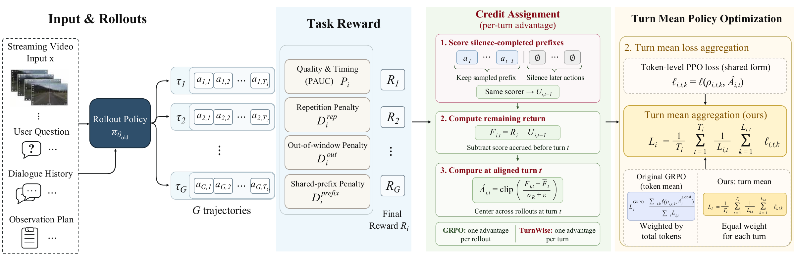
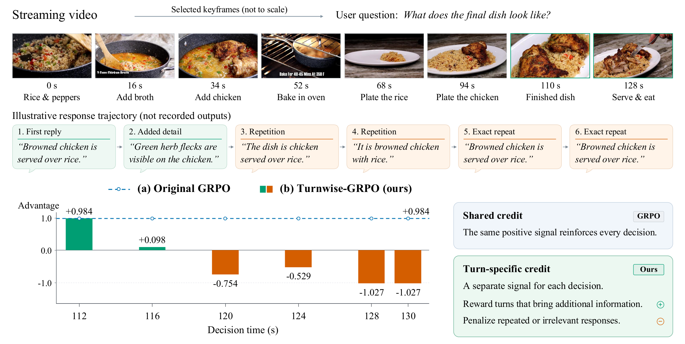
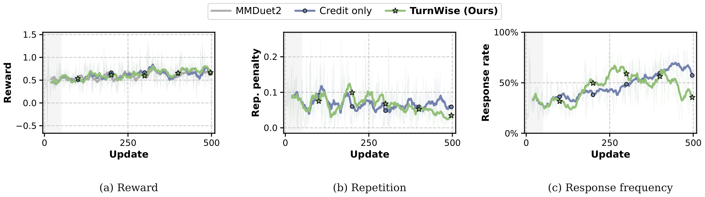
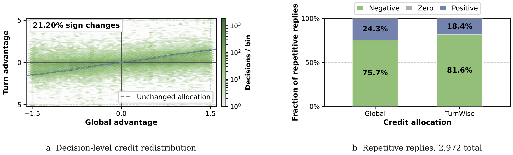

# Turns Matter: Advancing Streaming Video RL via Turn-Level Credit

[](https://arxiv.org/abs/2611.06728)
[](https://huggingface.co/shuai22/turns-matter-rl-ckpt)
[](https://huggingface.co/datasets/shuai22/mmduet2-training-data)

Official RL training code for **TurnWise**, a framework for learning when to respond and when to wait in streaming video conversations.

**Authors:** Shuai Dong, Kanghui Tian, Linghan Chen et al.

**Affiliations:** Fudan University; Shanghai Innovation Institute; JD.com; Stanford University;

---

## 📖 Abstract

Streaming video assistants must continually choose between answering and observing more frames. Assigning every decision the same trajectory-level GRPO advantage can reward repetition or suppress useful later answers. **TurnWise** instead compares the return remaining at each turn across sampled trajectories, using prefix scores obtained by replacing subsequent responses with silence. It also averages losses within each turn before averaging across turns, so long answers do not outweigh short waiting actions. Both mechanisms reuse existing rollout evaluations. Experiments on two Qwen backbones show stronger results across three streaming benchmarks. See the [paper](https://arxiv.org/abs/2611.06728) for the full abstract and methodology.



**Framework overview.** TurnWise combines turn-specific credit with equal weighting of response and waiting decisions. The implementation includes prefix reward computation, group-relative credit assignment, and turn-mean policy loss.

<details>
<summary>Why do turns matter?</summary>



A successful trajectory may still contain redundant replies. TurnWise separates the learning signal for each decision from rewards earned earlier in the conversation. The dialogue above is illustrative; the plotted advantages are based on recorded training decisions.

</details>

---

## 📢 News

- **[2026-11-05]** 🚀 The RL training code is released. Model checkpoints are hosted at [shuai22/turns-matter-rl-ckpt](https://huggingface.co/shuai22/turns-matter-rl-ckpt), and prepared training data at [shuai22/mmduet2-training-data](https://huggingface.co/datasets/shuai22/mmduet2-training-data).
- **[2026-11-04]** 📄 The paper is available on [arXiv](https://arxiv.org/abs/2611.06728).

---

## 🛠️ Installation

### 1. Environment setup

Use **Python 3.10** and a CUDA environment compatible with **PyTorch 2.6.0**.

```bash
conda create -n turnwise python=3.10
conda activate turnwise

git clone https://github.com/XD111ds/turn-wise-rl.git
cd turn-wise-rl

python -m pip install -r requirements.txt
python -m pip install flash-attn==2.7.4.post1 --no-build-isolation
```

### 2. Prepare verl and SGLang

TurnWise provides source overrides for specific revisions of [verl](https://github.com/verl-project/verl) and [SGLang](https://github.com/sgl-project/sglang). Use dedicated checkouts, since the installer copies the overrides into them.

```bash
mkdir -p third_party
git clone https://github.com/verl-project/verl.git third_party/verl
git -C third_party/verl checkout 83ebd007e01de29bbe353de112d04245b4820b47

git clone https://github.com/sgl-project/sglang.git third_party/sglang
git -C third_party/sglang checkout dcae1fb2cd2def2a2eb4919c21f74e91d888d161

export VERL_PATH="$PWD/third_party/verl"
export SGLANG_PATH="$PWD/third_party/sglang"
python install.py --verl "$VERL_PATH" --sglang "$SGLANG_PATH"
```

The installer verifies the dependency revisions, applies the overrides, and installs both dependencies in editable mode. Training uses the Ray/FSDP/SGLang configuration in [`configs/train.yaml`](configs/train.yaml).

---

## 📚 Data Preparation

We use prepared MMDuet2 streaming training data. Download the **two-second-per-frame RL split** from [shuai22/mmduet2-training-data](https://huggingface.co/datasets/shuai22/mmduet2-training-data):

- `metadata/rl/`: training/validation parquet files and the user-turn annotation JSON.
- `media/rl/`: tar shards containing the prepared frames.

Download these directories into `data/` from the repository root:

```bash
python - <<'PY'
from huggingface_hub import snapshot_download

snapshot_download(
    repo_id="shuai22/mmduet2-training-data",
    repo_type="dataset",
    allow_patterns=["metadata/rl/*", "media/rl/*"],
    local_dir="data",
)
PY

mkdir -p data/datasets/mmduet2-frame/rl
for archive in data/media/rl/*.tar; do
    tar -xf "$archive" -C data/datasets/mmduet2-frame/rl
done
```

**Expected directory structure:**

```text
turn-wise-rl/
├── assets/
├── configs/
├── data/
│   ├── metadata/rl/
│   │   ├── ...-train.parquet
│   │   ├── ...-val.parquet
│   │   └── ...-user_turns.json
│   ├── media/rl/                      # Downloaded tar shards
│   └── datasets/mmduet2-frame/rl/     # Extracted frame directories
├── overrides/
│   ├── verl/
│   └── sglang/
├── qwen_vl_utils/
├── recipe/proactive/
├── third_party/
├── install.py
├── requirements.txt
├── train.sh
└── README.md
```

**Data format:** parquet examples contain `prompt` (initial conversation), `images` (frame references), `data_source`, `reward_model` (ground-truth answers and reply windows), and `extra_info` (including video-tool arguments). The user-turn JSON supplies subsequent observations for each `question_id`.

Set `FRAME_ROOT` to the absolute path of `data/datasets/mmduet2-frame/rl`, which directly contains the extracted dataset directories. The parquet uses paths such as `./data/datasets/EgoExoLearn/frames/...`; the training launcher links `FRAME_ROOT` to `./data/datasets` in its runtime directory so these references resolve correctly. Follow the dataset card for upstream data licenses and terms.

---

## 🚀 Training

### 1. Configure paths and the reward judge

Prepare an **SFT checkpoint compatible with Qwen2.5-VL** for this training implementation. The trained TurnWise model is available on [Hugging Face](https://huggingface.co/shuai22/turns-matter-rl-ckpt). The paper also reports Qwen3-VL experiments; the supplied dependency overrides target Qwen2.5-VL.

The reward function requires an **OpenAI-compatible chat-completions endpoint**. The paper uses **gpt-oss-20b** as the training judge. Replace the model, output, and judge placeholders below; use absolute paths for filesystem locations.

```bash
# Run from the repository root, in the environment configured above.
export VERL_PATH="$PWD/third_party/verl"
export SGLANG_PATH="$PWD/third_party/sglang"

DATA_PREFIX="$PWD/data/metadata/rl/live_whisperx-egoexo4d-egoexolearn0913-half_multi_half_single_question-2_sec_per_frame-20s_seg_as_example-0714-max_90_frames"
export MODEL_PATH="/absolute/path/to/your/sft-checkpoint"
export TRAIN_PARQUET="${DATA_PREFIX}-train.parquet"
export RL_USER_TURNS_JSON="${DATA_PREFIX}-user_turns.json"
export FRAME_ROOT="$PWD/data/datasets/mmduet2-frame/rl"
export OUTPUT_DIR="/absolute/path/to/turnwise-output"

export LLM_EVALUATOR_URL="http://YOUR_JUDGE_HOST:PORT/v1/chat/completions"
export LLM_EVALUATOR_MODEL="YOUR_JUDGE_MODEL_NAME"
# If authentication is required:
# export LLM_EVALUATOR_API_KEY="YOUR_API_KEY"
```

For multiple judge endpoints, set `LLM_EVALUATOR_URLS` to a comma-separated list and keep `LLM_EVALUATOR_URL` set. Optional judge settings are defined in [`recipe/proactive/reward_function.py`](recipe/proactive/reward_function.py).

### 2. Launch training

```bash
bash train.sh
```

**Default hyperparameters:**

| Setting | Value |
| --- | --- |
| Compute | 1 node, 8 GPUs |
| Training batch size | 8 |
| Rollouts per input | 4 |
| Video observations | Up to 90 frames, one every 2 seconds |
| Learning rate / epochs | `1e-6` / 1 |
| Sampling temperature / top-k | 1.2 / 10 |
| Policy loss aggregation | `turn-mean` |
| Credit correction strength | Linear warmup from 0 to 1 over the first 10% of scheduled optimizer updates, then fixed at 1 |
| Turn advantage clipping | ±5 |
| Vision tower | Frozen |
| KL / entropy regularization | Disabled |

Hydra overrides can be passed after `bash train.sh`. For example:

```bash
bash train.sh trainer.experiment_name=turnwise-run
```

---

## 📊 Results

Aggregate scores from [Table 1 of the paper](https://arxiv.org/html/2611.06728v1#S4.T1); higher is better for all columns.

| Backbone | Method | ProactiveVQA PAUC | OVO-Timing F1 | StreamingBench Avg. |
| --- | --- | ---: | ---: | ---: |
| Qwen2.5-VL-3B | SFT | 28.74 | 0.57 | 48.74 |
| Qwen2.5-VL-3B | MMDuet2 | 39.60 | 17.72 | 47.64 |
| Qwen2.5-VL-3B | **TurnWise** | **43.56** | **21.59** | **49.43** |
| Qwen3-VL-4B | SFT | 30.24 | 1.60 | 56.58 |
| Qwen3-VL-4B | MMDuet2 | 30.18 | 9.23 | 53.84 |
| Qwen3-VL-4B | **TurnWise** | **42.44** | **11.15** | **58.96** |

<details>
<summary>Training dynamics and credit allocation</summary>



Turn-mean aggregation produces higher late-stage reward and less repetition than credit-only optimization in the analyzed training run.



Among repetitive replies with positive global advantages in the analyzed cohort, 59.83% receive negative turn-level advantages. See the paper for the cohort definition and full analysis.

</details>

---

## 📝 Citation

If you find TurnWise useful, please cite our paper:

```bibtex
@article{dong2026turns,
  title={Turns Matter: Advancing Streaming Video RL via Turn-Level Credit},
  author={Dong, Shuai and Tian, Kanghui and Chen, Linghan and Shao, Wenqi and Wu, Hongrui and Hou, Haowen and Zhu, Yongfu and Wang, Xuehui and Wang, Ziyue and Liu, Wenpu and Xie, Weichu and Xu, Yuqi and Wang, Congcong and Tuo, Kaiwen and Ma, Caoyuan and Wu, Taiqiang and Zhao, Ji and Chang, Wenzheng and Wang, Dianyi and Wang, Siyuan and Wei, Zhongyu and Qiao, Yu and Wang, Jiaqi},
  journal={arXiv preprint arXiv:2611.06728},
  year={2026},
  url={https://arxiv.org/abs/2611.06728}
}
```

## 🙏 Acknowledgements

This codebase builds on [verl](https://github.com/verl-project/verl), [SGLang](https://github.com/sgl-project/sglang), [Qwen2.5-VL](https://github.com/QwenLM/Qwen2.5-VL), [Transformers](https://github.com/huggingface/transformers), and the [MMDuet2]([https://github.com/verl-project/verl](https://github.com/yellow-binary-tree/MMDuet2)) streaming training setup. We thank the authors for their open-source contributions.

## 📄 Third-party Licenses

The verl and SGLang overrides derive from projects licensed under **Apache-2.0**. Their original licenses and notices remain in the corresponding dependency checkouts and must be retained when redistributing derived code. Dataset licenses and terms are described in the linked dataset repository.
